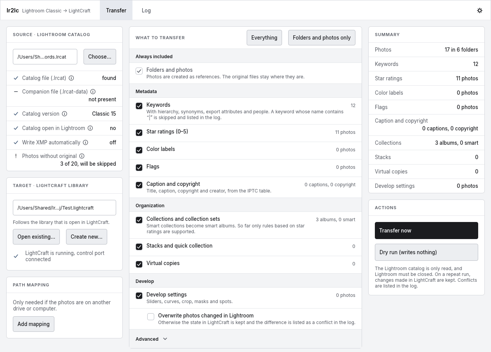
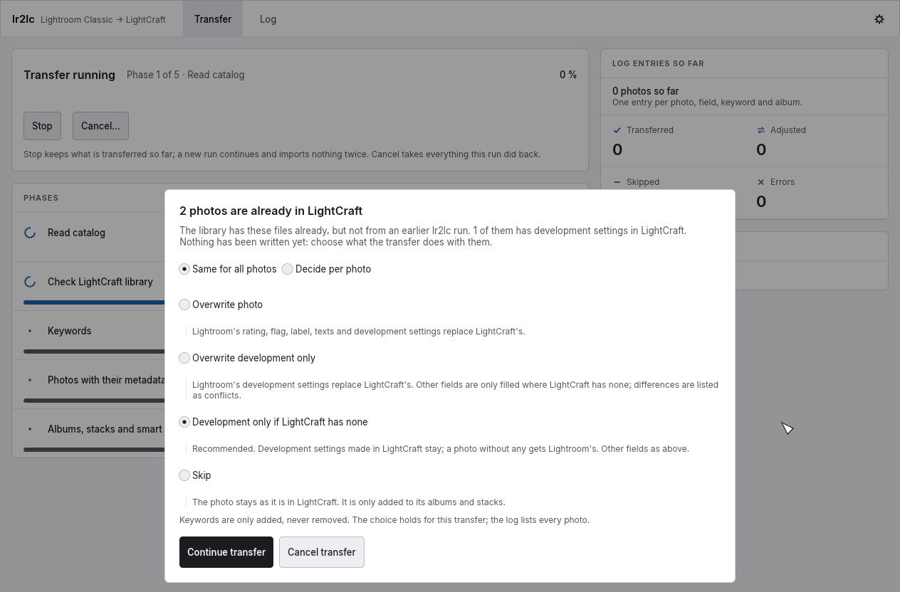
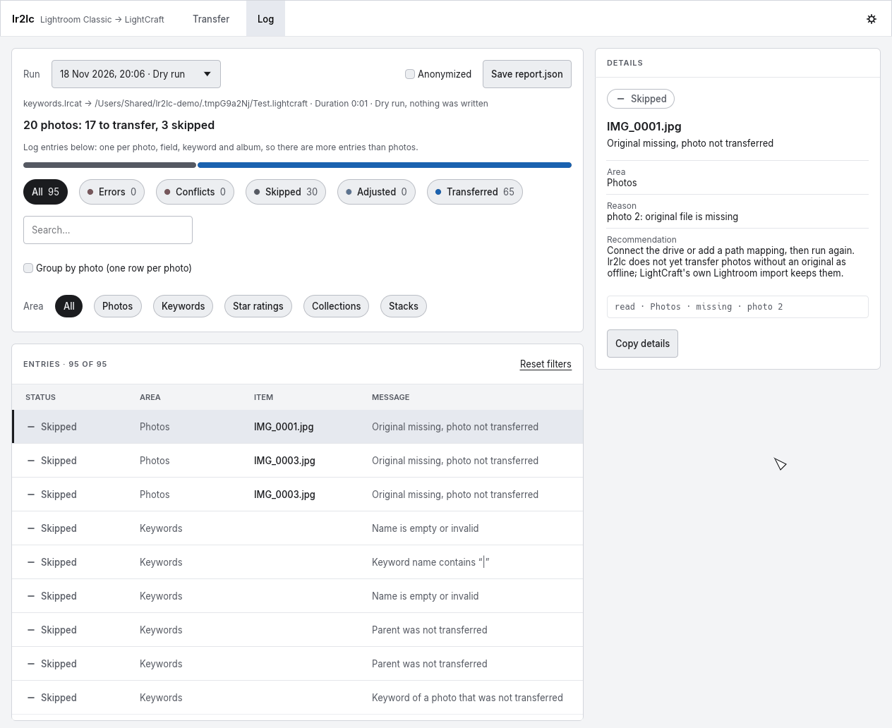

<div align="center">


# lr2lc

**Move your Adobe Lightroom Classic catalog into [LightCraft](https://github.com/storytold/lightcraft),<br>with keywords, albums, ratings and edits. Safe to run again.**

[](https://github.com/Jo-ReverseLab/lr-classic-to-lightcraft/actions/workflows/ci.yml)
[](#license)
[](https://www.rust-lang.org)
[](docs/limits.md)

<picture>
  <source media="(prefers-color-scheme: dark)" srcset="docs/images/window-transfer-dark.png">
  
</picture>

</div>

lr2lc (short for Lightroom Classic to LightCraft) reads a Lightroom Classic
catalog (`.lrcat`) **read-only** and writes what it finds into a running
LightCraft library. LightCraft can import a catalog itself; lr2lc adds what
a catalog that keeps changing needs: a re-sync that brings over only what
changed and reports conflicts instead of overwriting your LightCraft edits,
plus real smart albums, stacks, the Quick Collection and path mapping for
moved photos.

Your original photos are never touched, and nothing is written until you ask
for it: without that, every run is a dry run.

## What comes over

| From Lightroom Classic | To LightCraft |
| --- | --- |
| Folders and photos | Photos as references to the existing files (videos are skipped) |
| Virtual copies | Virtual copies with their master |
| Keywords with hierarchy, synonyms and attributes | Keywords and their assignments |
| Stars, pick/reject flags, colour labels | Ratings, flags, labels (via a label set) |
| Titles, captions, copyright, creator | The same fields |
| Collections and collection sets | Albums and album folders with their members |
| Smart collections | Smart albums, when every rule translates exactly (star ratings today) |
| Stacks, Quick Collection | Stacks (expanded), Quick Collection |
| Development settings | Sliders, tone curves, crop, Upright, white-balance mode, masks and spots |

Some parts are not converted yet, for example rotation and mirroring,
camera profiles and AI denoise. Each one is reported by name, never dropped
silently. The full list, with the issue for each:
[What works and what does not](docs/limits.md).

<table>
  <tr>
    <td width="50%">
      <picture>
        <source media="(prefers-color-scheme: dark)" srcset="docs/images/window-question-dark.png">
        
      </picture>
    </td>
    <td width="50%">
      <picture>
        <source media="(prefers-color-scheme: dark)" srcset="docs/images/window-log-dark.png">
        
      </picture>
    </td>
  </tr>
  <tr>
    <td align="center"><sub>Asks before it writes</sub></td>
    <td align="center"><sub>Every photo, keyword and album in the run log</sub></td>
  </tr>
</table>

## Quick start

You need a Lightroom Classic 15 catalog,
[LightCraft](https://github.com/storytold/lightcraft) on the same computer
and [Rust](https://rustup.rs) to build lr2lc.

```sh
git clone https://github.com/Jo-ReverseLab/lr-classic-to-lightcraft.git
cd lr-classic-to-lightcraft

# The desktop window (Rust 1.95 or later)
cargo run --release -p lr2lc-gui

# Or the command line (Rust 1.88 or later): a dry run first ...
cargo run --release -p lr2lc -- ~/Pictures/Lightroom/Catalog.lrcat

# ... then the transfer, with LightCraft started with `--control 7980`
cargo run --release -p lr2lc -- ~/Pictures/Lightroom/Catalog.lrcat \
  --library ~/Pictures/Photos.lightcraft --apply
```

Close Lightroom Classic first, and try the first transfer on a test library
you can delete. Turn off "Automatically write changes into XMP" in
Lightroom; [the setup notes](docs/limits.md#known-limits) explain why.

## Install

There are no prebuilt binaries yet. To install both programs into
`~/.cargo/bin`:

```sh
cargo install --locked --git https://github.com/Jo-ReverseLab/lr-classic-to-lightcraft lr2lc
cargo install --locked --git https://github.com/Jo-ReverseLab/lr-classic-to-lightcraft lr2lc-gui
```

## Documentation

| Page | Contents |
| --- | --- |
| [Desktop window](docs/desktop-window.md) | Transfer, the question before writing, Stop and Cancel, the run log |
| [Command line](docs/usage.md) | Every option, the dry run output, path mapping, re-sync, exit codes |
| [What works and what does not](docs/limits.md) | What is tested and every known limit, with its issue |
| [Report format](docs/report-format.md) | The fields of `report.json` |
| [Roadmap](ROADMAP.md) · [Changelog](CHANGELOG.md) | What is done and what comes next |

## Status

Early development: the version is 0.x and the command line may still
change. Only catalogs of Lightroom Classic 15 (`Adobe_DBVersion` 1500000)
are read. Transfers are tested live against LightCraft 0.21.1 on macOS; on
Linux and Windows only the automated tests run (CI checks formatting, lint
and tests on all three).

Bug reports and ideas are welcome in the
[issues](https://github.com/Jo-ReverseLab/lr-classic-to-lightcraft/issues).

## License

Licensed under either of

- Apache License, Version 2.0 ([LICENSE-APACHE](LICENSE-APACHE))
- MIT license ([LICENSE-MIT](LICENSE-MIT))

at your option.

This project is not affiliated with or endorsed by Adobe. "Lightroom" is
used only to describe compatibility.
