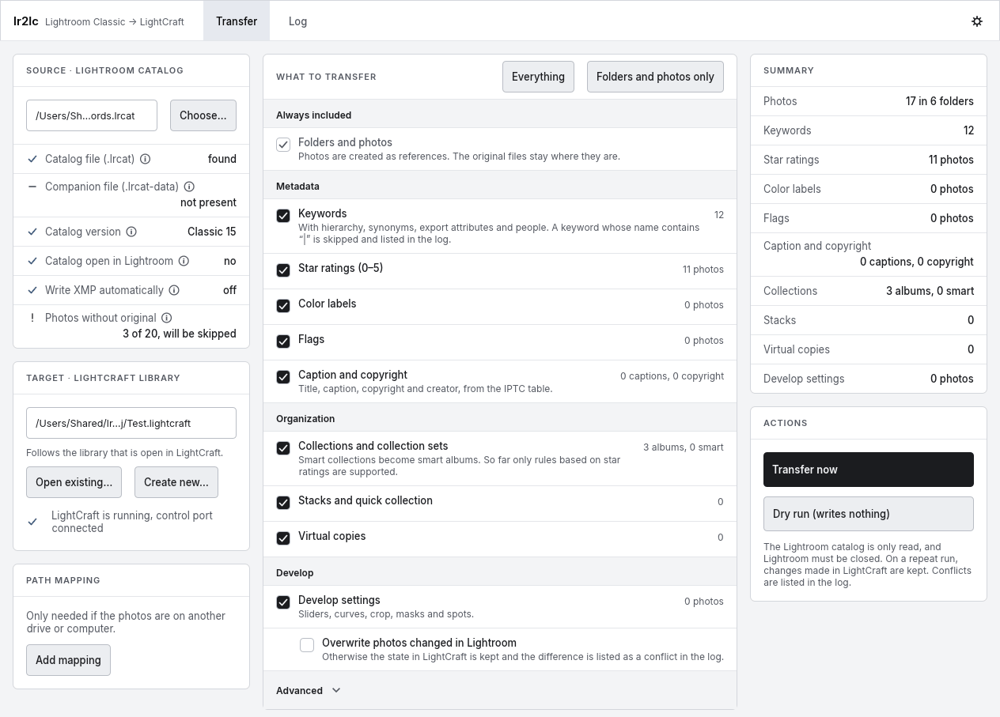
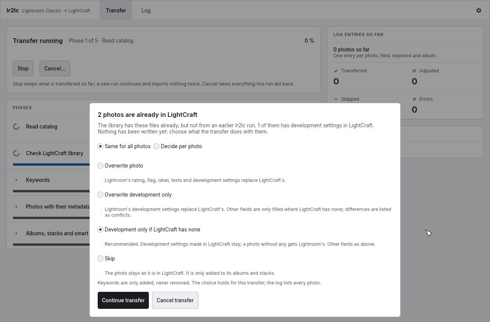
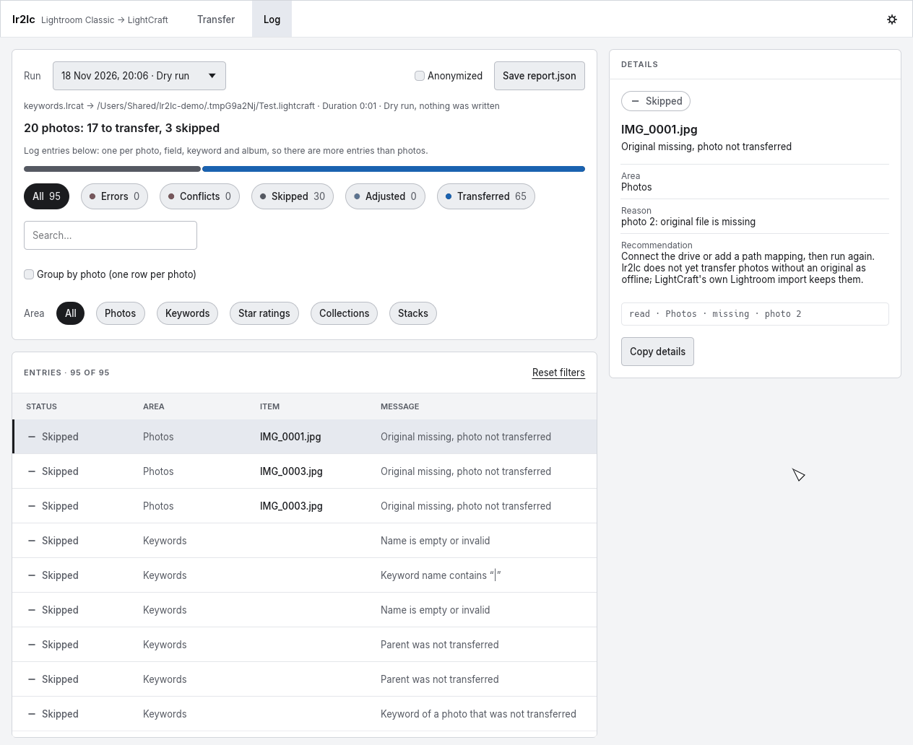

# Desktop window

[Back to the README](../README.md)

`lr2lc-gui` is a window for the same conversion: choose a catalog and a
LightCraft library, choose what to transfer, run a dry run or the
transfer, and read the run log. It runs `lr2lc-core` in its own process
and talks to LightCraft over the control port, like the command line.

```sh
cargo run --release -p lr2lc-gui   # needs Rust 1.95 or later
```

<picture>
  <source media="(prefers-color-scheme: dark)" srcset="images/window-transfer-dark.png">
  
</picture>

- **Transfer**: the catalog with its checks (file found, catalog version,
  open in Lightroom, LightCraft writing XMP automatically, photos without
  original, originals only in iCloud), the target library with
  LightCraft's connection, path mappings (kept per catalog), the parts to transfer (the same as
  [`--skip`](usage.md#--skip-areas)), the advanced options (label names, control
  port, continue despite XMP auto-write) and a summary from a read-only
  scan of the catalog. A blocking check disables the buttons and says why.
  Dropping a `.lrcat` file on the window chooses it.
- **Running**: progress per phase in the order lr2lc works (read the
  catalog, check the library, keywords, photos with their metadata and
  develop settings, albums and stacks), counters and the last log
  entries.

<picture>
  <source media="(prefers-color-scheme: dark)" srcset="images/window-question-dark.png">
  
</picture>

- **Before writing** the transfer asks in one window, only when there is
  something to decide, and writes nothing until it is answered:
  originals only in iCloud (before the library is checked: transfer
  anyway or cancel and download them first); photos the library already
  has, with the four [`--existing`](usage.md#--existing-choice) choices for all
  photos or per photo (with a filter for photos edited in LightCraft and
  **Show in LightCraft**, which selects the photo there); and photos an
  earlier run transferred that were deleted in LightCraft, imported again
  or left deleted (see [`--removed`](usage.md#--removed-choice)). **Cancel
  transfer** ends the run with nothing written.
- **Stop and Cancel**: **Stop** halts at the next photo and keeps what is
  transferred; a new run continues without duplicates. **Cancel** (after a
  confirmation) halts and takes the run back: photos, virtual copies,
  albums, keywords and stacks it added are removed from the library again
  (records only, never the original files), album members, Quick
  Collection photos and fields it changed are set back, and the mapping
  file is restored. Development settings it wrote to photos that were
  already in the library cannot be set back over the control port; the log
  lists them (`develop_not_reset`). `report.json` then has a `rollback`
  section with counts.

<picture>
  <source media="(prefers-color-scheme: dark)" srcset="images/window-log-dark.png">
  
</picture>

- **Log**: every run's [run log](usage.md#run-log), filterable by status, area and
  text, with details per entry. Runs are kept in the app's data folder
  (`~/Library/Application Support/lr2lc/runs` on macOS); **Save
  report.json** saves the report with names or, with **Anonymized**,
  without them.

The theme follows the system and can be switched in the top bar. The
window uses the Inter font (SIL Open Font License, see
`crates/lr2lc-gui/assets/fonts`).

Not available yet: **Retry this photo** and **Overwrite with Lightroom
state** in the Log are disabled until lr2lc can run a single photo
([#36](https://github.com/Jo-ReverseLab/lr2lc/issues/36)). There is no
pause, and the spinner does not follow the system's reduced-motion
setting.
